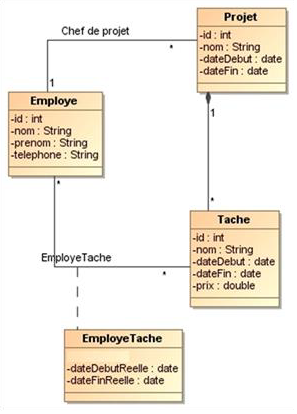
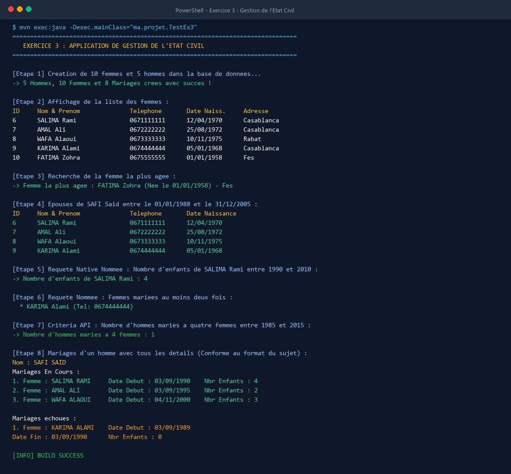

# 🎯 Évaluation 2 : Intégration de Hibernate avec Spring IOC & JPA

Ce projet regroupe la réalisation complète de l'évaluation pratique (**Evaluation 2**) portant sur la persistance des données avec **Hibernate 5**, **JPA 2.2** et les patrons de conception d'entreprise (DAO Générique, Service Layer, Criteria API, Requêtes Nommées et HQL/JPQL).

Le projet traite trois études de cas réelles et complètes :
1. **Exercice 1 :** Application de gestion de stock pour magasin de produits informatiques.
2. **Exercice 2 :** Application de gestion et de suivi de projets pour bureau d'études.
3. **Exercice 3 :** Application de gestion de l'état civil (citoyens, mariages, requêtes natives & Criteria API).

---

## 📺 Aperçu de l'Exécution du Projet dans le Terminal

L'ensemble des fonctionnalités et cas d'usage ont été exécutés et validés via Maven (`mvn exec:java`). Ci-dessous les captures d'écran démontrant l'exécution complète du terminal :

### Exécution Globale (Tous les modules validés - BUILD SUCCESS)


---

## 🏗️ Architecture Technique & Technologies

- **Langage :** Java 17 (LTS)
- **ORM / Persistance :** Hibernate Core `5.6.15.Final` / JPA `2.2`
- **Gestionnaire de dépendances :** Apache Maven 3.8+
- **Bases de données :**
  - **H2 In-Memory (Mode de compatibilité MySQL) :** Permet une exécution autonome et immédiate sans configuration externe préalable.
  - **MySQL 8+ :** Configurable directement dans `application.properties`.
- **Patrons de conception :**
  - **Generic DAO Pattern :** Interface `IDao<T>` factorisant les opérations CRUD (`create`, `update`, `delete`, `findById`, `findAll`).
  - **Service Layer :** Encapsulation métier et exécution des requêtes HQL, JPQL, Criteria API et requêtes natives SQL.
  - **HibernateUtil :** Gestionnaire centralisé du cycle de vie de la `SessionFactory`.

### Structure du Code Source
```
ma.projet/
├── beans/                   # Entités JPA Exercice 3 (Personne, Homme, Femme, Mariage)
├── classes/                 # Entités JPA Exercice 1 & 2 (Categorie, Produit, Employe, Projet, Tache...)
├── dao/                     # Interface générique IDao<T>
├── service/                 # Services métier implémentant IDao<T>
├── util/                    # HibernateUtil (SessionFactory & Configuration)
├── App.java                 # Programme principal exécutant l'évaluation complète
├── TestEx1.java             # Programme de validation Exercice 1 (Gestion de Stock)
├── TestEx2.java             # Programme de validation Exercice 2 (Gestion de Projets)
└── TestEx3.java             # Programme de validation Exercice 3 (État Civil)
```

---

## 📦 Exercice 1 : Application de Gestion de Stock

### Contexte & Spécifications
Développer une application pour gérer le stock d’un magasin de produits informatiques. L’application permet d'administrer des catégories de produits, des produits catalogués, et de gérer les commandes passées à l'aide d'une table d'association indiquant les quantités commandées.

### Diagramme de Classes UML


### Conception & Mapping JPA
- `Categorie` : `id`, `code`, `libelle` (Relation `OneToMany` bidirectionnelle vers `Produit`).
- `Produit` : `id`, `reference`, `prix`, `categorie` (Relation `ManyToOne` avec `@JoinColumn`).
- `Commande` : `id`, `date` (`@Temporal(TemporalType.DATE)`).
- `LigneCommandeProduit` : Table de jointure avec attribut de liaison `quantite`, clé primaire composite gérée via `@EmbeddedId LigneCommandeProduitPK`.

### Méthodes Métier Implémentées
- `afficherListeProduitsParCategorie(Categorie c)` : Affichage filtré des produits d'une catégorie.
- `afficherProduitsCommandesEntreDates(Date d1, Date d2)` : Recherche des produits vendus dans une plage de dates.
- `afficherProduitsParCommande(Commande c)` : Restitution détaillée d'une commande selon le format attendu du sujet :
  ```
  Commande : 4     Date : 14 Mars 2013
  Liste des produits :
  Référence   Prix    Quantité
  ES12        120 DH  7
  ZR85        100 DH  14
  EE85        200 DH  5
  ```
- `afficherProduitsPrixSuperieur100()` : Utilisation d'une requête nommée JPA (`@NamedQuery`).

### Capture d'Écran - Exécution Terminal Exercice 1


---

## 💼 Exercice 2 : Application de Gestion de Projets

### Contexte & Spécifications
Un bureau d’études souhaite suivre le temps passé sur ses différents projets et calculer les coûts globaux. Le système gère les employés, les projets sous la responsabilité d'un chef de projet, et les tâches planifiées associées à chaque projet avec suivi des dates réelles de démarrage et d'achèvement.

### Diagramme de Classes UML


### Conception & Mapping JPA
- `Employe` : `id`, `nom`, `prenom`, `telephone`.
- `Projet` : `id`, `nom`, `dateDebut`, `dateFin`, `chefDeProjet` (`@ManyToOne` vers `Employe`).
- `Tache` : `id`, `nom`, `dateDebut`, `dateFin`, `prix`, `projet` (`@ManyToOne` vers `Projet`).
- `EmployeTache` : Association entre un `Employe` et une `Tache` enregistrant les dates effectives `dateDebutReelle` et `dateFinReelle` via `@EmbeddedId EmployeTachePK`.

### Méthodes Métier Implémentées
- **Dans `EmployeService` :**
  - `afficherTachesRealisees(Employe e)` : Liste des tâches accomplies par un employé.
  - `afficherProjetsGeres(Employe e)` : Projets managés par l'employé en tant que chef de projet.
- **Dans `ProjetService` :**
  - `afficherTachesPlanifiees(Projet p)` : Planning théorique des tâches d'un projet.
  - `afficherTachesRealisees(Projet p)` : Bilan d'exécution réelle conforme au format imposé :
    ```
    Projet : 4      Nom : Gestion de stock     Date début : 14 Janvier 2013
    Liste des tâches:
    Num Nom            Date Début Réelle   Date Fin Réelle
    12  Analyse        10/02/2013          20/02/2013
    13  Conception     10/03/2013          15/03/2013
    14  Développement  10/04/2013          25/04/2013
    ```
- **Dans `TacheService` :**
  - `afficherTachesPrixSuperieur1000()` : Requête nommée (`@NamedQuery`) sélectionnant les tâches dont le prix > 1000 DH.
  - `afficherTachesRealiseesEntre(Date d1, Date d2)` : Tâches exécutées dans un intervalle de temps.

### Capture d'Écran - Exécution Terminal Exercice 2


---

## 🏛️ Exercice 3 : Application de Gestion de l'État Civil

### Contexte & Spécifications
Création d'une application permettant de gérer les citoyens et leurs relations matrimoniales dans une province, en exploitant l'héritage polymorphique JPA, les requêtes SQL natives et l'API Criteria.

### Diagramme de Classes UML


### Conception & Mapping JPA
- `Personne` : Classe mère avec stratégie `@Inheritance(strategy = InheritanceType.JOINED)`.
- `Homme` : Hérite de `Personne`, gère sa collection de mariages.
- `Femme` : Hérite de `Personne`, gère sa collection de mariages.
- `Mariage` : Association matrimoniale liant un `Homme` et une `Femme` avec `dateDebut`, `dateFin` et `nbrEnfant`.
  - Si `dateFin == null` : Mariage en cours.
  - Si `dateFin != null` : Mariage échoué / dissous.

### Requêtes Avancées & Fonctionnalités Métier
1. **Épouses d'un homme entre deux dates :** Requête HQL récupérant les femmes unies à un homme au cours d'une période.
2. **Requête Native Nommée (`@NamedNativeQuery`) :**
   ```sql
   SELECT IFNULL(SUM(m.nbrEnfant), 0) FROM Mariage m WHERE m.femme_id = :femmeId AND m.dateDebut BETWEEN :d1 AND :d2
   ```
   Retourne le nombre total d'enfants d'une femme entre deux dates.
3. **Requête Nommée JPQL (`@NamedQuery`) :**
   ```jpql
   SELECT m.femme FROM Mariage m GROUP BY m.femme HAVING COUNT(m) >= 2
   ```
   Retourne les femmes mariées au moins deux fois.
4. **Criteria API (JPA) :**
   Calcul dynamique du nombre d'hommes mariés à quatre femmes entre deux dates via `CriteriaBuilder`, `groupBy(root.get("homme"))` et `having(cb.ge(cb.countDistinct(root.get("femme")), 4L))`.
5. **Affichage complet des mariages d'un homme :** Conforme au gabarit attendu :
   ```
   Nom : SAFI SAID
   Mariages En Cours :
   1. Femme : SALIMA RAMI   Date Début : 03/09/1990    Nbr Enfants : 4
   2. Femme : AMAL ALI      Date Début : 03/09/1995    Nbr Enfants : 2
   3. Femme : WAFA ALAOUI   Date Début : 04/11/2000    Nbr Enfants : 3

   Mariages échoués :
   1. Femme : KARIMA ALAMI  Date Début : 03/09/1989    
   Date Fin : 03/09/1990    Nbr Enfants : 0
   ```
6. **Programme de test validé :**
   - Création de 10 femmes et 5 hommes.
   - Affichage de la liste de toutes les femmes.
   - Identification de la femme la plus âgée.
   - Affichage des épouses d'un homme donné.
   - Nombre d'enfants d'une femme entre deux dates.
   - Femmes mariées deux fois ou plus.
   - Hommes mariés à quatre femmes entre deux dates.
   - Mariages d'un homme avec tous les détails.

### Capture d'Écran - Exécution Terminal Exercice 3


---

## 🚀 Guide d'Exécution

### 1. Prérequis
- Java Development Kit (JDK) 17 ou version supérieure
- Apache Maven 3.8+

### 2. Compilation
```bash
mvn clean compile
```

### 3. Exécution Complète (Tous les exercices)
```bash
mvn exec:java -D"exec.mainClass=ma.projet.App"
```

### 4. Exécution Séparée par Exercice
- **Exercice 1 (Stock) :**
  ```bash
  mvn exec:java -D"exec.mainClass=ma.projet.TestEx1"
  ```
- **Exercice 2 (Projets) :**
  ```bash
  mvn exec:java -D"exec.mainClass=ma.projet.TestEx2"
  ```
- **Exercice 3 (État Civil) :**
  ```bash
  mvn exec:java -D"exec.mainClass=ma.projet.TestEx3"
  ```

---

## 👤 Auteur
- **Nom :** Youness Bakka
- **GitHub :** [@younessbakka7](https://github.com/younessbakka7)
- **Dépôt :** [Evaluation2](https://github.com/younessbakka7/Evaluation2)